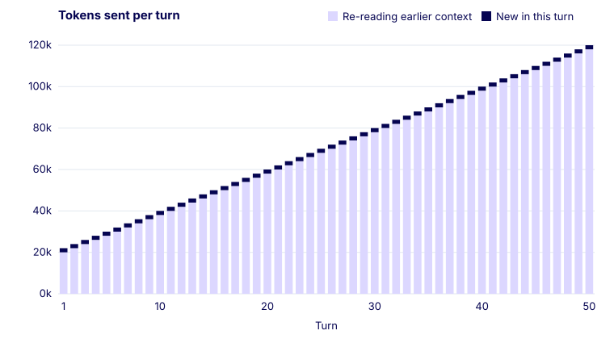

My weekly quota reset on Monday. By Wednesday afternoon, it was gone.

What I did that day was very ordinary. On Tuesday I had a project chat that I did not finish, so on Wednesday afternoon I opened the same session and kept going. Halfway through, I remembered a deployment question and asked a few things about it. There was an error I could not read, so I pasted in the whole log. Then the quota warning popped up.

My first thought was that something was broken. After some digging, I found the problem was not what I asked. It was that for every question I asked, the AI re-read everything from Tuesday to Wednesday from the start. And after a night away, the cache had long expired, so my first message was re-read at full price.

I spent some time to understand this, and I ended up with five habits. I use Claude Code as the example below. Most of it also works for Codex and Cursor, only the commands are a bit different.

One more thing: saving tokens does not mean being stingy or asking fewer questions. The longer and messier the context is, the easier it is for the AI to lose focus. It forgets the rules you set, gets pulled off course by an unrelated log, and picks the wrong point in outdated information. So managing context saves more than money. The work also gets better.

First, four terms that will come up again and again:

- **token**: The smallest unit the AI uses to read and write text, and also the unit of billing. Roughly, one English word is about one to two tokens.
- **context**: Everything the model can "see" this time. This includes what you said, the files it read, and the output of the commands it ran.
- **cache**: If the start of what you send is exactly the same as last time, the server can skip processing that part, and it charges much less.
- **subagent**: A helper that the main conversation sends off to do a job. It has its own separate context, and it brings back only a summary when it is done.

## Where the money actually goes

Most tokens are not spent on the words you type. They are spent on re-reading the context, over and over. Once you understand this, you can work out most of the later tips yourself.

The model remembers nothing between two requests. Each time you send a message, Claude Code packs up the system prompt, the project notes, the whole earlier conversation and the tool results, and sends them all again. Your new message is just attached at the end ([official docs](https://code.claude.com/docs/en/prompt-caching)).

It is like asking a coworker a question, but first you have to read your whole chat history to them from the start, and only then ask the new question. The longer you chat, the longer the reading gets.

There is one more layer that is easy to miss. Each time the agent uses a tool (reading a file, running a command), it sends another request that carries the full history. You think you sent one message, but behind it there may be a dozen full requests.

Here is an example. The session starts with 20 thousand tokens of context, and each turn adds 2 thousand. The chart below shows how much is actually sent in each of 50 turns.

The big purple area is what you pay to re-read old content. The thin navy line on top is what is really new in each turn. In the last few turns, even if you only ask "what is this variable called?", you send more than a hundred thousand tokens with it. One casual question can burn several dollars.

So are long sessions crazy expensive? Not quite, because of the cache. The part that is the same as last time is re-read by the server at a much lower price.

But cheap is not free. The longer the context, the higher the base price of each turn. Two other items on the bill cost even more:

- **Output**: What the model writes. Its unit price is higher than input.
- **Thinking**: The model's "thinking" before it answers is also billed as output. The default budget can be tens of thousands of tokens per request ([source](https://code.claude.com/docs/en/costs)). The higher you set the thinking effort, the more it costs.

So a bill has roughly three parts: normal input, cache reads, and output (including thinking).

### What is in the context

The conversation is only one part. There are also the system prompt and tool definitions, project notes such as CLAUDE.md, every file it read, and the output of every command it ran.

The last two are often the biggest part, and they are the easiest to lose control of. If you ask it to read a 2,000-line file, or paste in a 10,000-line log, that content stays in the context. It is sent again in every later turn until you clear the session.

### Check your own numbers first

In Claude Code, type `/usage` to see how many tokens the current session used and what the cache hit rate is. `/context` shows what is taking up the context. For subscription users, `/usage` also lists tips ranked by share, for example a warning that one CLAUDE.md is too long and a big chunk of it goes into every request.

Now to the main part.

## Habit 1: Pick the right tier before you start

The first thing you can change is the model itself.

Big models are smarter and cost more. Small models are cheap and fast, and they are more than enough for simple jobs. Thinking effort works the same way: the deeper it thinks, the more output tokens it uses. Most daily tasks do not need the top tier.

The official advice for Claude Code is that Sonnet can handle most coding tasks, and Opus is for hard architecture decisions and problems that need multi-step reasoning ([source](https://code.claude.com/docs/en/costs)). Use `/model` to switch models and `/effort` to change the thinking effort. What I do myself is use Opus day to day, and switch to Fable only when I hit a really hard problem.

There is a trap here. Say you are working with Opus in a very long session, and a simple question comes up. You think you will just switch to a cheaper model and ask it. That actually costs more. Each model has its own cache, so after a mid-session switch, the next request has to re-read the whole history without the cache ([source](https://code.claude.com/docs/en/prompt-caching)). The longer the session, the more this hurts.

So pick the tier when you start, and do not change it halfway. If a simple question comes up, the cheapest way is to ask it in a new session.

Codex is the same. Pick the reasoning level by how hard the task is: a low level for small tasks with a clear scope, and a medium or high level for complex changes and debugging.

## Habit 2: Keep the context small

Of the five habits, I think this section matters most.

Think back to the chart above. Every extra thing in the context is paid for again in every later turn. Instead of trying to make each turn a little cheaper, it is better to stop the context from growing so big in the first place. Here are the tricks I use most.

### One task, one session

This is the simplest and most effective: when the topic changes, open a new session.

In the story at the start, I asked about deployment in the project session. Those few messages were useless for the project, but they were sent again with every later message. If I had asked in a separate session, I would not have paid that cost at all.

`/clear` opens a clean new session. If you do not want to lose the old one, give it a name with `/rename` before you clear. You can find it again later with `/resume`.

### Clear and compact are different

The other option is `/compact`. It summarizes the earlier conversation and replaces the long history with the summary.

The difference is that `/clear` just throws the history away, and it costs nothing. `/compact` has to read the whole conversation first to write the summary, so it is a big request in itself ([source](https://code.claude.com/docs/en/costs)).

If you still need the earlier conclusions later, compact. If you do not, clear. It is best to compact at a natural pause between tasks, not to wait until the context is almost full and let it trigger automatically in the middle of a task. You can also tell it what to focus on, for example `/compact keep the test results and the files I changed`.

### Use a handover file instead of the whole history

A long task can rarely be finished in one session, and the longer a session runs, the heavier the context gets. What I do is this: at a good stopping point, I ask the AI to write the current state into a file. Then I open a new session, and my first message is "read this file first".

The next person on shift does not need to know what the last shift talked about. They only need to know the current situation and what to do next. A good handover file includes:

- **Goal**: What the task should look like when it is finished
- **Done**: What has been done, and which files were changed
- **Current state**: Where it is stuck, and which tests still fail
- **Next steps**: What to do next, in order
- **Pitfalls**: Approaches that were tried and did not work

Always write the last one. If you do not, the new session will likely suggest the approach you already rejected, and you will have to spend another turn to stop it.

A file like this is usually only a few hundred tokens, but it can replace tens of thousands of tokens of history. When you come back the next day, you can also see at a glance where you left off.

### Do not feed it big chunks

Often the context is made large by one single action. The three most common ones:

- **A vague request.** "Help me improve this project" makes it scan the whole repo. "Add input validation to the login function in auth.ts" only needs one or two files.
- **Pasting a whole log.** In a 10,000-line log, the useful part is often just a few error lines. Filter it yourself first, then paste.
- **Long test output.** As a more advanced step, you can write a hook so that after tests run, only the failed parts go to the AI. This can cut tens of thousands of tokens of output down to a few hundred ([source](https://code.claude.com/docs/en/costs)).

### Put your notes file on a diet

CLAUDE.md is loaded at the start of every session and carried in every turn after that. So its length is multiplied into a fixed cost for every turn.

The common problem is that people put everything in it: code style, folder layout, and also processes like "how to do a code review" or "how to do a database migration" that are only needed at certain times. When you work on unrelated tasks, these still take up space for nothing.

The official advice is to keep CLAUDE.md under 200 lines, keep only what is needed every time, and move specific processes into skills that load on demand ([source](https://code.claude.com/docs/en/costs)).

### Tools take up space too

Last are tools. MCP tools now load lazily by default, so at the start only the tool names enter the context. That is already much cheaper than before. Still, command-line tools like `gh` and `aws` are cheaper, since they do not take up space in the tool list at all. If you do not use an MCP server, you can turn it off in `/mcp`.

These tricks work on Codex almost as they are. OpenAI gives similar advice: one session for one complete unit of work, a short and precise AGENTS.md that you split up if it gets too big, an execution plan such as PLANS.md to pass long tasks between sessions, and only the tools you really use.

## Coming in Part 2

Part 1 was about what should and should not go into the context.

Part 2 is about getting more value from the same context: how to avoid breaking the cache, how to take fewer detours and redo less work, and when to hand the grunt work to a subagent. At the end there is a checklist that covers all five habits.

Keep reading: [Part 2](/blog/save-tokens-claude-code-2/)

## References

- [Manage costs effectively](https://code.claude.com/docs/en/costs): The official Claude Code docs on cost management
- [How Claude Code uses prompt caching](https://code.claude.com/docs/en/prompt-caching): The official Claude Code explanation of caching
- [Codex best practices](https://developers.openai.com/codex/learn/best-practices): OpenAI's best practices for Codex users
