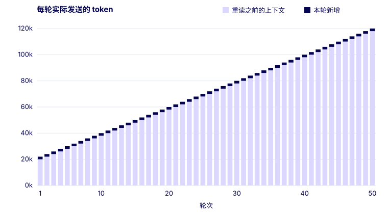

周一刚重置的周额度，周三下午就用完了。

那天我做的事很普通：周二有个项目没聊完，周三下午打开同一个会话接着聊。中途想起部署的事，顺手问了几句；有个报错看不懂，就把整份日志贴了进去。聊着聊着，额度提示弹了出来。

我第一反应是不是哪里出 bug 了。查下来才发现，问题不在我问了什么，而在我每问一句，它都要把周二到周三的全部内容从头读一遍。而且隔了一晚，缓存早就过期了，第一句话就是全价重读。

后来我花了点时间把这件事搞清楚，总结出五个习惯。下面以 Claude Code 为例讲讲，换成 Codex、Cursor 也基本成立，只是命令不太一样。

顺便说一句，省 token 不等于抠门、少问几句。上下文越长越杂，AI 越容易分心：忘掉你定好的规矩，被一份无关的日志带偏，在过时的信息里抓错重点。所以管好上下文，省下的不只是钱，活也干得更好。

先认识四个后面会反复出现的词：

- **token**：AI 读写文字的最小单位，也是计费单位。粗略地说，一个汉字大约是一到两个 token。
- **上下文**：模型这一次能“看见”的全部内容，包括你说的话、它读过的文件、它跑过的命令的输出。
- **缓存**：如果这次发的内容开头和上次一模一样，服务端可以不重新处理那一部分，收费也便宜得多。
- **子代理**：主对话派出去干活的帮手。它有自己独立的上下文，干完只带一份摘要回来。

## 钱到底花在哪儿

大部分 token 不是花在你打的字上，而是花在一遍又一遍地重读上下文上。想明白这一点，后面的技巧你基本能自己推出来。

大模型在两次请求之间什么都不记得。你每发一条消息，Claude Code 都要把系统提示、项目说明、之前的全部对话和工具结果打包重发一遍，你的新消息只是贴在最后（[官方文档](https://code.claude.com/docs/en/prompt-caching)）。

这就像每次找同事问问题，都得先把你们之前所有的聊天记录从头念给他听，念完了再问新问题。聊得越久，要念的越长。

还有一层更容易被忽略：agent 每用一次工具（读文件、跑命令），就要再发一次带着全部历史的请求。你以为自己只发了一条消息，背后可能是十几次完整的请求。

举个例子：会话开始时上下文是 2 万 token，之后每一轮增加 2 千。下面这张图画的是 50 轮里每一轮实际发出去的量。

紫色那一大片是为重读旧内容付的量，顶上那条细细的深蓝色才是每一轮真正新增的。到了最后几轮，你哪怕只问一句“这个变量叫什么”，也得背着十几万 token 一起发出去。一个随口的问题，就可能烧掉好几美金。

那长会话岂不是贵得离谱？其实没那么夸张，因为有缓存：和上一次一样的开头部分，服务端会按便宜得多的价格重读。

但便宜不等于免费，上下文越长，每一轮的“底价”就越高。账单里还有两样更贵的：

- **输出**：模型写出来的内容，单价比输入高。
- **思考**：模型回答之前的“想一想”也按输出计费，默认预算每次请求可能就有好几万 token（[来源](https://code.claude.com/docs/en/costs)）。思考强度开得越高，花得越多。

所以一张账单大致是三块：普通输入、缓存读取、输出（含思考）。

### 上下文里到底塞了什么

对话只是一部分。还有系统提示和工具定义、CLAUDE.md 这类项目说明书、它读过的每个文件，以及它跑过的每条命令的输出。

最后两项往往是大头，也最容易失控。让它读一个两千行的文件，或者贴进一份一万行的日志，这些内容会一直留在上下文里，之后每一轮都带上，直到你清空会话。

### 先看看你自己的数字

在 Claude Code 里输入 `/usage`，能看到当前会话用了多少 token、缓存命中率是多少；`/context` 能看到上下文被哪些东西占着。订阅用户的 `/usage` 还会按占比列出优化建议，比如提醒你某个 CLAUDE.md 太长、每次请求都要带上一大截。

下面进入正题。

## 习惯一：开工前选对档位

第一个能动的是模型本身。

大模型更聪明也更贵，小模型便宜、快，简单的活绰绰有余。思考强度同理，想得越深，输出的 token 越多。大部分日常任务用不到最高档。

Claude Code 官方的建议是：Sonnet 能应付绝大多数编码任务，Opus 留给复杂的架构决策和需要多步推理的问题（[来源](https://code.claude.com/docs/en/costs)）。用 `/model` 换模型，用 `/effort` 调思考强度。我自己的用法是日常用 Opus，真遇到难题要攻坚，再换 Fable 模型。

这里有个坑。你在一个很长的会话里用 Opus 干活，突然冒出个简单问题，心想切到便宜的模型问一下就好。结果反而更贵：每个模型的缓存是分开的，中途一换，下一次请求就得把整段历史不走缓存地重读一遍（[来源](https://code.claude.com/docs/en/prompt-caching)）。会话越长，这一下越疼。

所以档位开工时就选好，中途别动。真有简单问题，另开一个新会话去问最划算。

Codex 也一样，按任务难度选推理档位：范围明确的小任务用低档，复杂的改动和调试用中高档。

## 习惯二：让上下文保持小

五个习惯里，我觉得这一节最重要。

回想前面那张图：上下文里每多一样东西，之后每一轮都要为它再付一次钱。与其琢磨怎么让每一轮便宜一点，不如从源头别让上下文长那么大。我常用的有下面几招。

### 一件事，一个会话

最简单也最有效：换了话题，就开新会话。

开头那件事里，我在那个项目的会话里顺手问了部署的事。那几句讨论对项目本身毫无用处，却跟着之后的每一条消息一起发了出去。当时要是另开一个会话问，这笔钱根本不用花。

`/clear` 就能开一个干净的新会话。舍不得旧会话，清空前先用 `/rename` 起个名字，以后用 `/resume` 还能找回来。

### 清空和压缩，别搞混

另一个选项是 `/compact`：把之前的对话总结成一段摘要，替换掉原来的长历史。

区别在于，`/clear` 是直接扔掉，不花钱；`/compact` 得先把整段对话读一遍才写得出摘要，它本身就是一次大请求（[来源](https://code.claude.com/docs/en/costs)）。

后面还用得上前面的结论，就压缩；用不上，就清空。压缩最好挑任务之间的自然停顿来做，别拖到上下文快满了、在任务做到一半时自动触发。压缩时还能指定重点，比如 `/compact 保留测试结果和改过的文件`。

### 用一份交接文档代替整段历史

长任务很少能在一个会话里干完，会话拖得越久，上下文越重。我的做法是：干到一个段落，让 AI 把当前状态写进一个文件，然后开新会话，第一句话就是“先读这个文件”。

下一班的人不需要知道上一班聊了什么，只需要知道现在什么情况、接下来干什么。一份够用的交接文档包括：

- **目标**：这件事最终要做成什么样
- **已完成**：做了哪些，改了哪些文件
- **当前状态**：卡在哪儿，哪些测试还没过
- **下一步**：接下来按什么顺序做
- **踩过的坑**：试过但行不通的方案

最后一项一定要写。不写的话，新会话很可能兴冲冲地把你否掉的方案又提一遍，你还得再花一轮去拦它。

这样一份文档通常只有几百 token，却能顶替几万 token 的历史。隔天你自己回来，也能一眼看懂做到哪儿了。

### 别把大块头喂进去

很多时候上下文是被一次操作撑大的，最常见的三种：

- **需求太模糊**。“帮我改进一下这个项目”会让它满仓库地扫；“给 auth.ts 的登录函数加上输入校验”只需要读一两个文件。
- **整份日志直接贴**。一万行日志里有用的往往就那几行报错，先自己筛一遍再贴。
- **测试输出太长**。进阶一点，可以写一个 hook，测试跑完只把失败的部分交给 AI，能把几万 token 的输出压到几百（[来源](https://code.claude.com/docs/en/costs)）。

### 给说明书减肥

CLAUDE.md 每个会话一开始就加载，之后每一轮都带着，所以它的长度会被放大成每一轮的固定成本。

常见问题是什么都往里写：代码规范、目录结构，再加上“怎么做代码审查”“怎么做数据库迁移”这类只在特定时候用得上的流程。做无关任务时，这些也一直白占地方。

官方建议把 CLAUDE.md 控制在 200 行以内，只留每次都需要的东西，特定流程挪到按需加载的 skill 里（[来源](https://code.claude.com/docs/en/costs)）。

### 工具也会占地方

最后是工具。现在的 MCP 工具默认延迟加载，一开始只有工具名进入上下文，已经比以前省多了。不过 `gh`、`aws` 这类命令行工具还是更省，连工具列表都不占。用不到的 MCP 服务器，可以在 `/mcp` 里关掉。

这几招放到 Codex 上几乎原样成立。OpenAI 的建议同样是一个会话对应一个完整的工作单元，AGENTS.md 要短而准、太大就拆开，长任务用 PLANS.md 这样的执行计划来接力，工具只接真正用得上的。

## 下篇预告

上篇说的都是上下文里该放什么、不该放什么。

下篇讲怎么让同样的上下文花得更值：怎么别把缓存打断，怎么少走弯路、少返工，什么时候该把脏活派给子代理。最后还有一张覆盖全部五个习惯的检查清单。

继续阅读：[下篇](/zh/blog/save-tokens-claude-code-2/)

## 参考

- [Manage costs effectively](https://code.claude.com/docs/en/costs)：Claude Code 官方成本管理文档
- [How Claude Code uses prompt caching](https://code.claude.com/docs/en/prompt-caching)：Claude Code 官方缓存说明
- [Codex best practices](https://developers.openai.com/codex/learn/best-practices)：OpenAI 给 Codex 用户的最佳实践
